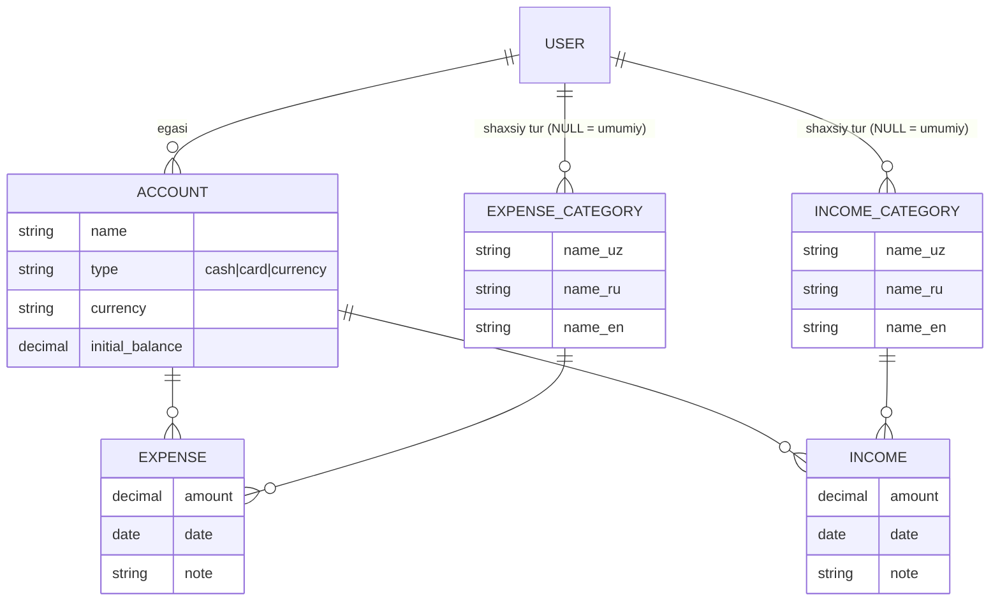

# 💰 Kirim-Chiqim API

Shaxsiy **kirim va chiqimlarni nazorat qiluvchi** REST API.
Django REST Framework asosida, **3 tilda** (o'zbek, rus, ingliz) ishlaydi va **Docker** orqali bitta buyruq bilan ishga tushadi.

> Backend Python Django (Standart) — 8-oy imtihon loyihasi

---

## 🔐 Login va parollar

| Rol | Login | Parol | Imkoniyatlari |
|---|---|---|---|
| **Admin** | `admin` | `admin12345` | Barcha foydalanuvchilarning hisob, kirim, chiqimlarini ko'radi; umumiy turlarni yaratadi/o'zgartiradi; `/admin/` paneliga kiradi |
| **User** | `user` | `user12345` | Faqat o'z hisoblari, kirim-chiqimlari va hisobotlari bilan ishlaydi |

Bu foydalanuvchilar `python manage.py seed` buyrug'i bilan avtomatik yaratiladi (Docker'da o'zi bajariladi). `user` uchun 3 ta hisob va namunaviy kirim-chiqimlar ham qo'shiladi.

---

## 🧩 Imkoniyatlar

- **Hisoblar** — Naqd pul / Karta / Valyuta (UZS, USD, EUR, RUB). Balans avtomatik hisoblanadi
- **Chiqim turlari** — Yo'l kira / Tushlik / Salomatlik ...
- **Kirim turlari** — Oylik / Avans / Kunlik ish haqi ...
- **Chiqimlar** va **Kirimlar** — Summa, Sana, Hisob, Tur, Izoh
- **Hisobotlar** — Kunlik / Haftalik / Oylik / ixtiyoriy davr bo'yicha kirim va chiqim summalari, turlar va kunlar kesimida
- **3 til** — `Accept-Language: ru` sarlavhasi yoki `?lang=en` parametri
- **JWT autentifikatsiya**, **admin va user rollari**
- Filtrlash, qidiruv, saralash, sahifalash
- Swagger hujjatlari: `/api/docs/`
- Postman kolleksiyasi: `docs/Kirim-Chiqim.postman_collection.json`

### Biznes qoidalar
1. Chiqim summasi hisobdagi qoldiqdan **oshmasligi** kerak.
2. Foydalanuvchi faqat **o'z hisobiga** kirim/chiqim yoza oladi.
3. Admin yaratgan tur — **hammaga umumiy** (oddiy user uni faqat o'qiydi). User yaratgan tur — faqat o'ziga.
4. Kirim/chiqimi bor hisob yoki turni **o'chirib bo'lmaydi** (400 xato, ma'lumot yo'qolmaydi).
5. Tranzaksiyasi bor hisobning **valyutasini o'zgartirib bo'lmaydi**.
6. Hisobotda summalar **valyuta bo'yicha alohida** — so'm va dollar qo'shib yuborilmaydi.

---

## 🗂 Ma'lumotlar modeli



**Hisobotlar** alohida jadval emas — ular `Expense` va `Income` jadvallaridan SQL agregatsiya (`SUM`, `GROUP BY`) orqali hisoblanadi.

---

## 🚀 Docker orqali ishga tushirish

```bash
git clone https://github.com/<username>/kirim-chiqim.git
cd kirim-chiqim
cp .env.example .env          # Windows: copy .env.example .env
docker compose up --build
```

Shundan so'ng:

| Manzil | Tavsif |
|---|---|
| http://localhost:8000/api/docs/ | Swagger hujjatlari |
| http://localhost:8000/api/ | Browsable API |
| http://localhost:8000/admin/ | Django admin (admin / admin12345) |

Konteyner ishga tushganda avtomatik: `migrate` → `compilemessages` → `collectstatic` → `seed` → `gunicorn`.

To'xtatish: `docker compose down` (ma'lumotlar bilan birga o'chirish: `docker compose down -v`).

## 💻 Lokal ishga tushirish (Docker'siz, SQLite)

```bash
python -m venv .venv
source .venv/bin/activate        # Windows: .venv\Scripts\activate
pip install -r requirements.txt
python manage.py migrate
python manage.py seed
python manage.py runserver
```

Testlar: `python manage.py test`

---

## 📡 API endpointlar

Barcha so'rovlarga (login va ro'yxatdan o'tishdan tashqari) sarlavha qo'shiladi:
```
Authorization: Bearer <access_token>
Accept-Language: uz        # yoki ru, en
```

### Auth
| Metod | URL | Tavsif |
|---|---|---|
| POST | `/api/auth/login/` | Login → `access`, `refresh`, `user` |
| POST | `/api/auth/refresh/` | Yangi access token |
| POST | `/api/auth/register/` | Ro'yxatdan o'tish |
| GET / PATCH | `/api/auth/me/` | Mening profilim |
| GET | `/api/auth/users/` | Foydalanuvchilar (faqat admin) |

### Asosiy resurslar (to'liq CRUD: GET, POST, GET/{id}, PUT, PATCH, DELETE)
| URL | Resurs | Filtrlar |
|---|---|---|
| `/api/accounts/` | Hisoblar | `type`, `currency`, `search` |
| `/api/expense-categories/` | Chiqim turlari | `search` |
| `/api/income-categories/` | Kirim turlari | `search` |
| `/api/expenses/` | Chiqimlar | `date_from`, `date_to`, `account`, `category`, `amount_min`, `amount_max`, `search`, `ordering` |
| `/api/incomes/` | Kirimlar | (chiqimlar bilan bir xil) |

### Hisobotlar
| URL | Tavsif |
|---|---|
| `/api/reports/?period=daily&date=2026-10-27` | Kunlik |
| `/api/reports/?period=weekly` | Haftalik (dushanba–yakshanba) |
| `/api/reports/?period=monthly` | Oylik |
| `/api/reports/?period=custom&date_from=2026-10-01&date_to=2026-10-15` | Ixtiyoriy davr |
| `&account=1` | Faqat bitta hisob bo'yicha |
| `&user=2` | (admin) Tanlangan foydalanuvchi bo'yicha |

---

## 🧪 Misollar

**Login**
```http
POST /api/auth/login/
Content-Type: application/json

{"username": "user", "password": "user12345"}
```
```json
{
  "refresh": "eyJhbGciOi...",
  "access": "eyJhbGciOi...",
  "user": {"id": 2, "username": "user", "role": "user", "...": "..."}
}
```

**Chiqim qo'shish**
```http
POST /api/expenses/
Authorization: Bearer <access>
Accept-Language: ru

{"amount": 25000, "date": "2026-10-27", "account": 1, "category": 2, "note": "Tushlik"}
```
```json
{
  "id": 6, "amount": 25000.0, "date": "2026-10-27",
  "account": 1, "account_name": "Naqd pul", "currency": "UZS",
  "category": 2, "category_name": "Обед", "note": "Tushlik",
  "created_at": "2026-10-27T21:50:00+05:00"
}
```

**Qoldiq yetmasa** (`Accept-Language: en`)
```json
{"amount": ["Insufficient funds in the account. Available balance: 453000.00 UZS"]}
```

**Oylik hisobot** — `GET /api/reports/?period=monthly`
```json
{
  "period": "monthly",
  "date_from": "2026-10-01",
  "date_to": "2026-10-31",
  "totals": [
    {"currency": "USD", "income": 50.0,      "expense": 20.0,     "difference": 30.0},
    {"currency": "UZS", "income": 6800000.0, "expense": 337000.0, "difference": 6463000.0}
  ],
  "income_by_category": [
    {"category_id": 1, "category": "Oylik", "currency": "UZS", "total": 5000000.0}
  ],
  "expense_by_category": [
    {"category_id": 3, "category": "Salomatlik", "currency": "UZS", "total": 250000.0}
  ],
  "by_day": [
    {"date": "2026-10-17", "currency": "UZS", "income": 5000000.0, "expense": 0}
  ]
}
```

---

## 📬 Postman

1. Postman → **Import** → `docs/Kirim-Chiqim.postman_collection.json`
2. **Auth → Login (user)** yoki **Login (admin)** ni yuboring — token avtomatik saqlanadi.
3. Tilni almashtirish: kolleksiya → **Variables** → `lang` = `uz` / `ru` / `en`.
4. "Yaratish" so'rovlari yangi yozuv `id` sini o'zgaruvchiga saqlaydi, shuning uchun keyingi "Bitta yozuv / Tahrirlash / O'chirish" so'rovlari shu yozuv bilan ishlaydi.

Har bir so'rovning tavsifi (documentation) kolleksiya ichida yozilgan. Onlayn hujjat kerak bo'lsa: kolleksiya → **⋯ → View documentation → Publish**.

---

## 🏗 Loyiha tuzilmasi

```
kirim-chiqim/
├── config/               # settings, urls, wsgi, til middleware
├── users/                # login (JWT), register, me, foydalanuvchilar ro'yxati
├── finance/
│   ├── models.py         # Account, ExpenseCategory, IncomeCategory, Expense, Income
│   ├── serializers.py    # validatsiya va biznes qoidalar
│   ├── views.py          # ViewSet'lar + ReportView (hisobotlar)
│   ├── permissions.py    # IsOwnerOrAdmin
│   ├── filters.py        # sana/summa/hisob/tur bo'yicha filtr
│   ├── tests.py          # API testlari
│   └── management/commands/seed.py
├── locale/ru, locale/en  # tarjima fayllari (.po / .mo)
├── docs/                 # Postman kolleksiyasi
├── Dockerfile
├── docker-compose.yml
└── entrypoint.sh
```

## 🌐 3 tilli qo'llab-quvvatlash qanday ishlaydi

1. **Tizim xabarlari** (xatolar, maydon nomlari, hisob turlari) — Django i18n: `gettext` + `locale/*/django.po`. Asosiy til — o'zbekcha.
2. **Foydalanuvchi kiritgan nomlar** (kirim/chiqim turlari) — har bir tur 3 ta maydonda saqlanadi: `name_uz`, `name_ru`, `name_en`. API `name` maydonini so'rov tiliga qarab qaytaradi; tarjima bo'sh bo'lsa o'zbekchasi chiqadi.
3. Til tanlash tartibi: `?lang=` → `Accept-Language` sarlavhasi → `uz`.

## 🛠 Texnologiyalar

Python 3.12 · Django 5 · Django REST Framework · SimpleJWT · django-filter · drf-spectacular · PostgreSQL 16 · Gunicorn · WhiteNoise · Docker Compose
